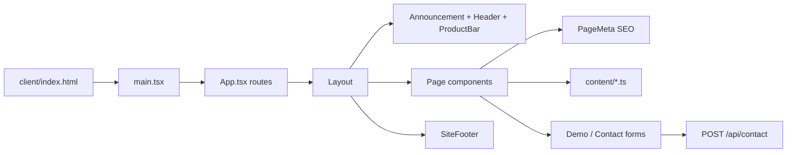
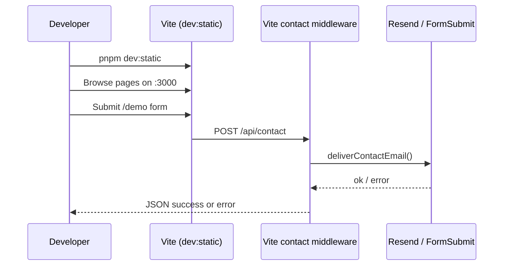
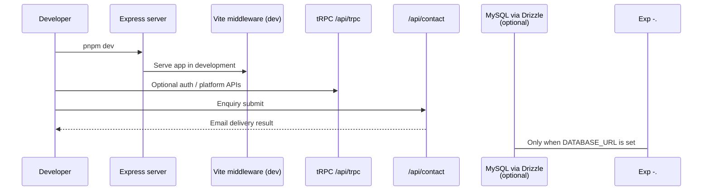
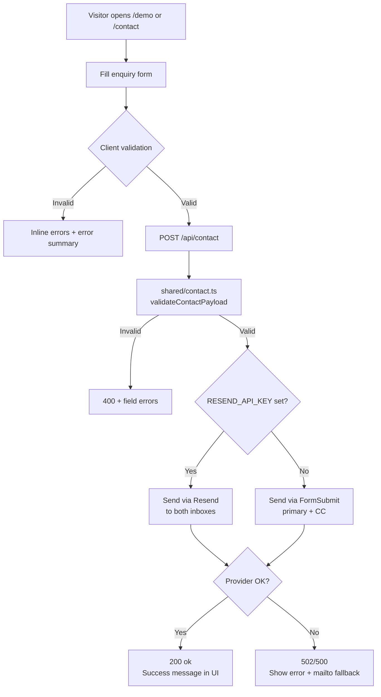
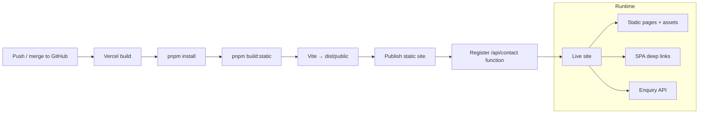
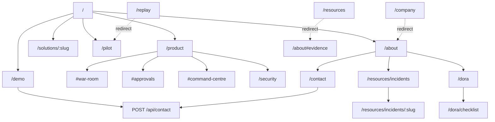
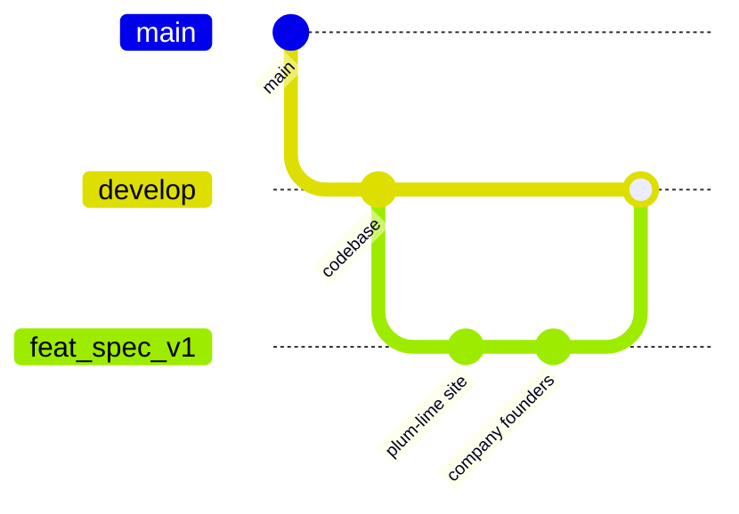

# Relyxus — Incident Response, With Control

Public marketing website for **Relyxus**, built and maintained by **Apporine**.

Relyxus helps regulated payments teams investigate incidents with evidence in one place and keep proposed actions behind policy and human approval.

This repository ships:

- A Vite + React marketing site (primary Vercel deployment target)
- Optional Express / tRPC / Drizzle backend (full-stack local mode)
- A contact / demo enquiry API that emails the Apporine team

**Default branch:** `main`  
**Active product branch:** `feat/spec-v1` (Plum & Lime site; merge to `develop` via PR)

---

## Table of contents

1. [Quick start](#quick-start)
2. [Repository layout](#repository-layout)
3. [Site model](#site-model)
4. [Architecture overview](#architecture-overview)
5. [Local development flows](#local-development-flows)
6. [Enquiry / contact email flow](#enquiry--contact-email-flow)
7. [Vercel deployment flow](#vercel-deployment-flow)
8. [Routing map](#routing-map)
9. [Scripts](#scripts)
10. [Environment variables](#environment-variables)
11. [Quality checks](#quality-checks)
12. [Git workflow](#git-workflow)
13. [Tech stack](#tech-stack)

---

## Quick start

**Requirements**

- Node.js `22.x` (see `.nvmrc`)
- pnpm `10.18.0` (via `packageManager` field)

```bash
pnpm install

# Marketing site only (recommended for UI work)
pnpm dev:static

# Full Express + Vite app
pnpm dev
```

Open [http://localhost:3000](http://localhost:3000).

Production-style static build:

```bash
pnpm build:static
pnpm preview
```

---

## Repository layout

```text
relyxus-website/
├── api/                  # Vercel serverless functions (contact email)
├── client/               # Vite React app (marketing site)
│   ├── public/           # logo.svg, favicon, robots.txt, sitemap, OG cover
│   └── src/
│       ├── components/
│       │   ├── layout/   # Header, product bar, footer, announcement
│       │   ├── sections/ # Heroes, walkthrough, flow diagrams, forms
│       │   ├── product/  # Incident record / screen previews
│       │   └── ui/       # Button, Accent, Section, Reveal, DrawBars
│       ├── content/      # Copy decks (home, company, product, incidents…)
│       ├── pages/        # Route-level pages
│       ├── styles/       # tokens.css + layout/sections (no Tailwind)
│       └── lib/          # SEO, scrollToHash, analytics, enquiry
├── server/               # Express app, tRPC, contact route, tests
├── shared/               # Shared contracts (contact validation, constants)
├── scripts/              # prerender.mjs, check-tokens.mjs
├── drizzle/              # Schema + SQL migrations (optional DB path)
├── vercel.json           # Static output + SPA rewrites + API function
├── vite.config.ts        # Vite + local /api/contact middleware
└── package.json
```

---

## Site model

### Visual system

**Plum & Lime** — EcoOnline-style marketing structure with Relyxus colours:

| Token role              | Purpose                                                  |
| ----------------------- | -------------------------------------------------------- |
| Canvas (`--canvas`)     | Softened plum chrome (header, heroes, product bar)       |
| Paper / white           | Light content bands                                      |
| Lime (`--primary`)      | CTAs and accent phrases                                  |
| DM Sans                 | Body and display                                         |
| Instrument Serif italic | One accent phrase per headline (`*phrase*` via `Accent`) |
| IBM Plex Mono           | Product UI / timestamps                                  |

Raw colours live only in `client/src/styles/tokens.css`. `pnpm check` runs `scripts/check-tokens.mjs` so other files cannot introduce hex/rgb literals.

### Information architecture

| Nav           | What it is                                                               |
| ------------- | ------------------------------------------------------------------------ |
| **Product**   | One product, three modules: War Room, Approvals, Command Centre          |
| **Solutions** | Engineering, resilience, leadership role pages                           |
| **Pilot**     | Read-only replay pilot                                                   |
| **Company**   | About (founders + trust ledger), Security, incident files, DORA, Contact |

There is **no Resources hub**. Evidence lives under Company and deep links:

- `/resources/incidents` — public incident files
- `/dora` / `/dora/checklist` — regulatory deadlines
- `/resources` redirects to `/about#evidence`

### Founders (Company / About)

Named on `/about`, matching Apporine:

- **Bisma Idrees** — Founder (DevOps / AIOps)
- **Syed Aoon** — Founder · AI & full-stack

Copy and the trust ledger live in `client/src/content/company.ts`. Do not invent certifications; status rows stay honest (`In product` / `In progress` / `Planned`).

### Product bar

On Product, Solutions, and Pilot pages, a sticky bar links to `#war-room`, `#approvals`, and `#command-centre`. Same-page hashes scroll in-place; cross-page clicks park the target and land on `/product`.

---

## Architecture overview

High-level system shape for the marketing site on Vercel, with the optional Express path for local full-stack work.

```mermaid
flowchart TB
  subgraph Visitors
    U[Browser visitor]
  end

  subgraph Vercel["Vercel (production)"]
    CDN[Static assets<br/>dist/public]
    SPA[SPA rewrite → index.html]
    FN["Serverless function<br/>/api/contact"]
  end

  subgraph Local["Local development"]
    VITE[Vite dev server<br/>pnpm dev:static]
    EXP[Express + Vite<br/>pnpm dev]
  end

  subgraph Delivery["Email delivery"]
    RESEND[Resend API<br/>preferred]
    FORMSUBMIT[FormSubmit<br/>fallback]
    INBOX1[aoon.syed@apporine.com]
    INBOX2[bisma.idrees@apporine.com]
  end

  U --> CDN
  U --> SPA
  U -->|POST enquiry| FN
  U -.-> VITE
  U -.-> EXP

  FN --> RESEND
  FN --> FORMSUBMIT
  VITE -->|same contact logic| RESEND
  VITE --> FORMSUBMIT
  EXP -->|POST /api/contact| RESEND
  EXP --> FORMSUBMIT

  RESEND --> INBOX1
  RESEND --> INBOX2
  FORMSUBMIT --> INBOX1
  FORMSUBMIT --> INBOX2
```

### Frontend composition



---

## Local development flows

### Option A — Static marketing site (matches Vercel)



Use this when working on marketing pages, SEO, layout, and the enquiry form.

### Option B — Full Express stack



Use this when extending server routers, auth, storage, or database behaviour.

---

## Enquiry / contact email flow

The demo form (`/demo`) and contact page (`/contact`) are live. Submissions are emailed to:

- `aoon.syed@apporine.com`
- `bisma.idrees@apporine.com`



### Implementation map

| Layer                        | Path                                     | Role                                              |
| ---------------------------- | ---------------------------------------- | ------------------------------------------------- |
| Shared validation + delivery | `shared/contact.ts`                      | Payload rules, email body, Resend/FormSubmit send |
| Vercel function              | `api/contact.ts`                         | Production `POST /api/contact`                    |
| Express route                | `server/contact.ts`                      | Local full-stack `POST /api/contact`              |
| Vite middleware              | `vite.config.ts`                         | Local static-dev `POST /api/contact`              |
| Demo form                    | `client/src/pages/Demo.tsx` + `DemoForm` | Validation, submit, success/error                 |
| Contact page                 | `client/src/pages/Contact.tsx`           | Enquiry topics + reply promise                    |

### First-time FormSubmit note

If `RESEND_API_KEY` is not set, the first FormSubmit delivery may send an activation email to `aoon.syed@apporine.com`. Confirm that email once so later enquiries flow normally.

---

## Vercel deployment flow

Configured in `vercel.json`:

- **Install:** `pnpm install`
- **Build:** `pnpm build:static` (Vite + prerender)
- **Output:** `dist/public`
- **SPA rewrite:** all non-`/api/*` routes → `index.html`
- **Function:** `api/contact.ts`



### Recommended Vercel env vars

| Variable             | Required    | Purpose                                                     |
| -------------------- | ----------- | ----------------------------------------------------------- |
| `RESEND_API_KEY`     | Recommended | Preferred transactional email provider                      |
| `CONTACT_FROM_EMAIL` | Optional    | Verified sender, e.g. `Relyxus Website <hello@your-domain>` |

Without Resend, FormSubmit fallback is used (see note above).

Deploy from **`develop`** (or the branch Vercel tracks) once `feat/spec-v1` is merged. `main` remains the repository default.

---

## Routing map

Client routes live in `client/src/App.tsx`.



Legacy redirects (also in `App.tsx`): `/pricing` → product pricing, `/product/investigation` → `#war-room`, `/deployment` → `/security`, `/integrations` → `#fit`, and related aliases.

SEO helpers:

- Per-page meta via `PageMeta` + `content/pageMeta.json`
- `client/public/robots.txt`
- `client/public/sitemap.xml`
- Brand mark: `client/public/logo.svg` / `favicon.svg`
- Social image: `client/public/og-cover.png` (or SVG if present)

---

## Scripts

| Command             | Description                                         |
| ------------------- | --------------------------------------------------- |
| `pnpm dev:static`   | Vite marketing site on port `3000`                  |
| `pnpm dev`          | Express + Vite full stack                           |
| `pnpm build:static` | Production static build + prerender → `dist/public` |
| `pnpm build`        | Static build + bundled Express server → `dist/`     |
| `pnpm start`        | Run bundled Express server (`dist/index.js`)        |
| `pnpm preview`      | Preview static production build                     |
| `pnpm check`        | TypeScript + token colour guard                     |
| `pnpm test`         | Vitest unit tests                                   |
| `pnpm format`       | Prettier write                                      |
| `pnpm ci`           | format check → check → test → build:static          |
| `pnpm db:migrate`   | Apply Drizzle migrations                            |
| `pnpm db:push`      | Generate + migrate schema changes                   |

---

## Environment variables

See `.env.example`.

| Variable               | Used by                   | Notes                                        |
| ---------------------- | ------------------------- | -------------------------------------------- |
| `RESEND_API_KEY`       | Contact delivery          | Preferred path for production email          |
| `CONTACT_FROM_EMAIL`   | Contact delivery          | Must be allowed/verified by Resend           |
| `PORT`                 | Express                   | Defaults to `3000`                           |
| `DATABASE_URL`         | Drizzle / server          | Optional; unused for static marketing deploy |
| `MANUS_*` / OAuth vars | Platform template helpers | Only needed for full platform/auth features  |

Never commit real secrets. Configure production values in the Vercel project settings.

---

## Quality checks

Automated gates keep the branch deployable:

| Gate               | When                   | What runs                                                         |
| ------------------ | ---------------------- | ----------------------------------------------------------------- |
| Husky `pre-commit` | Every local commit     | `lint-staged` (Prettier) → `pnpm check` → `pnpm test`             |
| Husky `pre-push`   | Every local push       | `pnpm build:static`                                               |
| GitHub Actions CI  | Push / PR to `develop` | format check, typecheck, tests, static build, output verification |

Before opening a PR:

```bash
pnpm ci
```

Contact smoke check (with local static server running):

1. Open `/demo`
2. Submit a valid enquiry
3. Confirm success UI
4. Confirm inbox delivery (or FormSubmit activation on first use)
5. Confirm `/contact` works

---

## Git workflow



Practical rules:

1. Keep **`main`** as the GitHub default branch.
2. Land product work on **`develop`** via PRs (from `feat/spec-v1` or smaller feature branches).
3. Prefer small, reviewable PRs (feature / fix / content / docs).
4. Do not push application code only to `main` unless promoting a release.

---

## Tech stack

| Area           | Choice                                                    |
| -------------- | --------------------------------------------------------- |
| UI             | React 19, Wouter, Lucide, custom CSS tokens (Plum & Lime) |
| Type           | DM Sans + Instrument Serif (accent) + IBM Plex Mono       |
| Build          | Vite 7, TypeScript 5.9, pnpm, prerender script            |
| API (optional) | Express, tRPC, Drizzle ORM, MySQL                         |
| Contact        | Shared validator + Resend / FormSubmit                    |
| Hosting        | Vercel static output + serverless `/api/contact`          |
| SEO            | Meta tags, canonical, OG/Twitter, robots, sitemap         |
| Analytics      | Vercel Analytics                                          |

---

## Product note

Marketing pages intentionally avoid invented certifications, customer logos, prices, or regulatory outcomes. Where availability depends on a customer environment or release, the site points visitors to an evaluation conversation instead of over-claiming.

Public incident files cite third-party post-incident reports; those firms are not Relyxus customers and have not endorsed Relyxus.

For enquiry follow-up, contact:

- `aoon.syed@apporine.com`
- `bisma.idrees@apporine.com`
